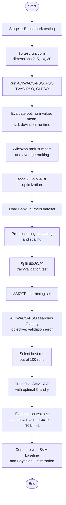
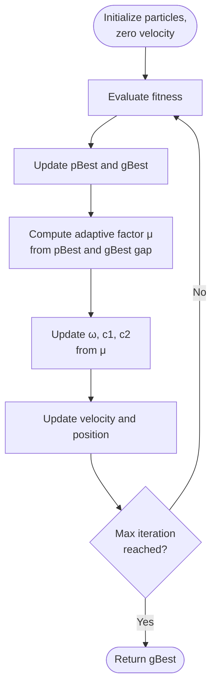

# ADIWACO-PSO for SVM-RBF Hyperparameter Optimization

This repository contains the code for the undergraduate thesis and the manuscript
"ADIWACO-PSO for SVM-RBF hyperparameter optimization on the BankChurners dataset",
S1 Sains Data, Universitas Telkom Purwokerto.

## Contents
| File | Description |
|---|---|
| `MAX_ITER.ipynb` | Benchmark experiment of ADIWACO-PSO, PSO, TVAC-PSO, and CLPSO on 10 benchmark functions (26 function–dimension scenarios) |
| `ADIWACO_SVM_BankChurners.ipynb` | SVM-RBF hyperparameter optimization (C, γ) with ADIWACO-PSO on BankChurners |

## Method summary
- Adaptive inertia weight and acceleration coefficients based on the relative fitness gap between pBest and gBest, following Sekyere et al.
- Benchmark: 26 function–dimension scenarios, evaluated with optimum value, mean, standard deviation, runtime, and the Wilcoxon rank-sum test.
- SVM: 60/20/20 train/validation/test split, SMOTE on the training set, 500 particles, 100 iterations, 100 independent runs.

## Benchmark functions
| No | Function | Type | Formula | Search domain | Global minimum | Dimensions |
|---|---|---|---|---|---|---|
| f1 | Schwefel 2.22 | Unimodal | $\sum_{i=1}^{n}\lvert x_i\rvert + \prod_{i=1}^{n}\lvert x_i\rvert$ | $[-10, 10]^n$ | $0$ | 2, 10, 30 |
| f2 | Zakharov | Unimodal | $\sum_{i=1}^{n}x_i^2 + \left(\sum_{i=1}^{n}0.5\,i\,x_i\right)^2 + \left(\sum_{i=1}^{n}0.5\,i\,x_i\right)^4$ | $[-10, 10]^n$ | $0$ | 2, 10, 30 |
| f3 | Dixon-Price | Unimodal | $(x_1-1)^2 + \sum_{i=2}^{n} i\,(2x_i^2 - x_{i-1})^2$ | $[-10, 10]^n$ | $0$ | 2, 10, 30 |
| f4 | Booth | Unimodal | $(x_1+2x_2-7)^2 + (2x_1+x_2-5)^2$ | $[-10, 10]^2$ | $0$ | 2 |
| f5 | Trid | Unimodal | $\sum_{i=1}^{n}(x_i-1)^2 - \sum_{i=2}^{n}x_i x_{i-1}$ | $[-n^2, n^2]^n$ | $-n(n+4)(n-1)/6$ | 2, 10, 30 |
| f6 | Rastrigin | Multimodal | $10n + \sum_{i=1}^{n}\left[x_i^2 - 10\cos(2\pi x_i)\right]$ | $[-5.12, 5.12]^n$ | $0$ | 2, 10, 30 |
| f7 | Ackley N.1 | Multimodal | $-20\exp\left(-0.2\sqrt{\frac{1}{n}\sum_{i=1}^{n}x_i^2}\right) - \exp\left(\frac{1}{n}\sum_{i=1}^{n}\cos 2\pi x_i\right) + 20 + e$ | $[-32.768, 32.768]^n$ | $0$ | 2, 10, 30 |
| f8 | Styblinski-Tang | Multimodal | $\frac{1}{2}\sum_{i=1}^{n}\left(x_i^4 - 16x_i^2 + 5x_i\right)$ | $[-5, 5]^n$ | $\approx -39.166\,n$ | 2, 10, 30 |
| f9 | Michalewicz | Multimodal | $-\sum_{i=1}^{n}\sin(x_i)\left[\sin\left(i\,x_i^2/\pi\right)\right]^{2m}$ | $[0, \pi]^n$ | $-1.8013$ (n=2), $-4.6876$ (n=5), $-9.6601$ (n=10) | 2, 5, 10 |
| f10 | Levy N.13 | Multimodal | $\sin^2(3\pi x_1) + (x_1-1)^2\left[1+\sin^2(3\pi x_2)\right] + (x_2-1)^2\left[1+\sin^2(2\pi x_2)\right]$ | $[-10, 10]^2$ | $0$ | 2 |

The combinations give 26 function–dimension scenarios. Function definitions follow the standard forms compiled by Naser et al.

## Research flow

### ADIWACO-PSO loop

## Main results

### Benchmark functions
| Algorithm | Average rank |
|---|---|
| **ADIWACO-PSO** | **1.27** |
| CLPSO | 1.46 |
| PSO | 2.96 |
| TVAC-PSO | 4.00 |

### SVM-RBF on BankChurners
| Model | Accuracy | Precision | Recall | Macro F1 |
|---|---|---|---|---|
| Bayesian Optimization, RBF (Ünlü, previous study)* | 0.8600 | 0.7500 | 0.6400 | 0.6700 |
| SVM baseline | 0.9067 | 0.8206 | 0.8524 | 0.8351 |
| SVM + ADIWACO-PSO (C = 43.1650, γ = 0.006962) | **0.9112** | **0.8285** | **0.8587** | **0.8424** |

Precision, recall, and F1-score of the SVM models are macro-averaged.

\* Reported by a previous study on the same dataset and kernel with an 80/20 split and no class-imbalance treatment. It is included as an external reference, not as a result obtained under the same protocol.

## Dataset
BankChurners (Kaggle): 10,127 customers, 20 variables. The dataset is not included in this repository; download it from [Kaggle: Credit Card Customers](https://www.kaggle.com/datasets/sakshigoyal7/credit-card-customers) and place the CSV file in the same folder as the notebooks.

## References
1. Y. O. M. Sekyere, F. B. Effah, and P. Y. Okyere, "An Enhanced Particle Swarm Optimization Algorithm via Adaptive Dynamic Inertia Weight and Acceleration Coefficients," *Journal of Electronics and Electrical Engineering*, vol. 3, no. 1, pp. 50–64, 2024. https://doi.org/10.37256/jeee.3120243868
2. K. D. Ünlü, "Predicting Credit Card Customer Churn Using Support Vector Machine Based on Bayesian Optimization," *Communications Faculty of Sciences University of Ankara Series A1 Mathematics and Statistics*, vol. 70, no. 2, pp. 827–836, 2021. https://doi.org/10.31801/cfsuasmas.899206
3. BankChurners dataset, Kaggle: https://www.kaggle.com/datasets/sakshigoyal7/credit-card-customers

## Requirements
Python 3, numpy, pandas, scikit-learn, imbalanced-learn, scipy, matplotlib

## Author
Rosa Nur Aliana Sawafi
